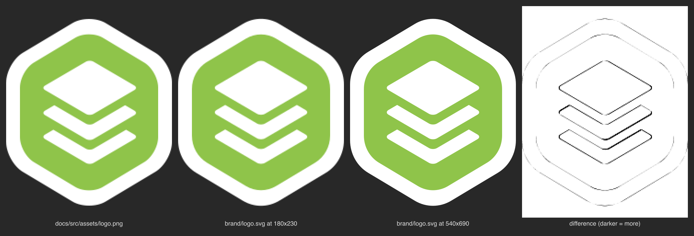

# xapiand-brand: journal

State: waiting on jobs 261111-113032-9b637e
Quest: .campaign/xapiand/quests/xapiand-brand.md (the lead's; never edit it)

## Doing

Waiting on the `icons` check (A3), job 261111-113032-9b637e, at 74136fcd0.

## Next

1. When the icons job is green, paste `campaign brief`'s table here and set State to "ready for review".

## Blocked on

Nothing.

## Evidence

| Criterion | Evidence |
|---|---|
| A1 | `brand/logo.svg` (3 paths, no raster or text); side by side: `brand/logo-vs-png.png` (PNG, master at 180x230, master at 3x, difference) |
| A2 | `brand/variants/light/` and `brand/variants/dark/`, each with logo.svg, favicon.svg, favicon.ico (16/32/48), apple-touch-icon.png, -152, -167, icon-192.png, icon-512.png |
| A3 | job 261111-113032-9b637e (`icons` check) pending |
| A4 | `brand/README.md` |

## Result

`brand/logo.svg` redraws `docs/src/assets/logo.png` from geometry measured on its pixels
(edge lines fitted to 0.02 px, corner radii by model fit): a regular hexagon with radius-39.3
corners stretched 1.039 tall (rim), its 5/6 copy (green hexagon), and three layers that are a
rotated rounded square (half-diagonal 52.66, corner 6.11) scaled 0.5848 tall, pitch 26.66, each
cut by the layer above moved down 10.58. With the raster's own layer offsets put back, a render
at 180x230 differs from the PNG by 0.55/255 mean (one pixel over 64/255); the committed master,
which centers the stack, differs by 1.72/255 mean, along the layer edges only.

`docs/scripts/build-icons.mjs` (`npm run icons`, sharp already a docs dependency, lockfile
unchanged) renders `light` and `dark` into `brand/variants/<name>/`; `brand/README.md` documents
the geometry, the derivation and the variants. docs/public and the page logo are untouched.

## Rulings I made

- Centered the layer stack on the hexagon's axis and spaced it evenly: the raster has the layers
  0.73 px right and the middle layer 0.61 px low (the outer two sit at -26.67 and +26.65 from the
  center). Measured, and shown in the difference panel of `brand/logo-vs-png.png`.
- Variants: `light` is the master (white rim) and the live one; `dark` drops the rim, whose white
  halo glares on a dark page, and crops to the green hexagon. Tiles use the docs theme page colors
  (#fdfdfc, #1a1a1a, the same as the Kronuz site's).
- Touch tiles draw the hexagon without the rim in both variants (the tile takes the rim's place),
  so the hexagon fills 74% of every tile.
- favicon.ico carries 16/32/48 frames, as the quest lists, not Kronuz's 64-256 extras.
- The script writes only brand/ (no `--live` copy into docs/public), since the site keeps its assets.
- The comparison image lives at `brand/logo-vs-png.png`, inside the quest's file set.
